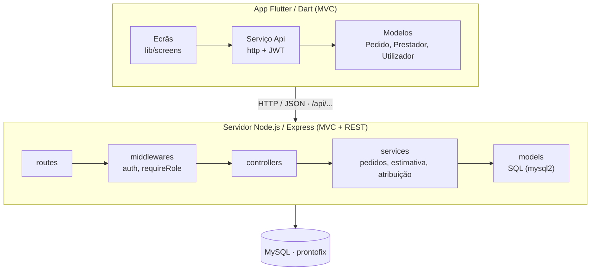
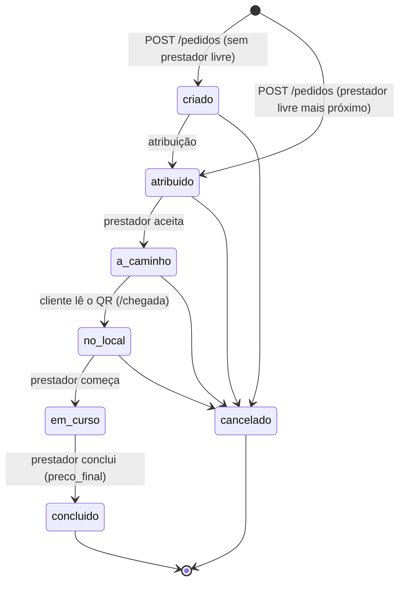
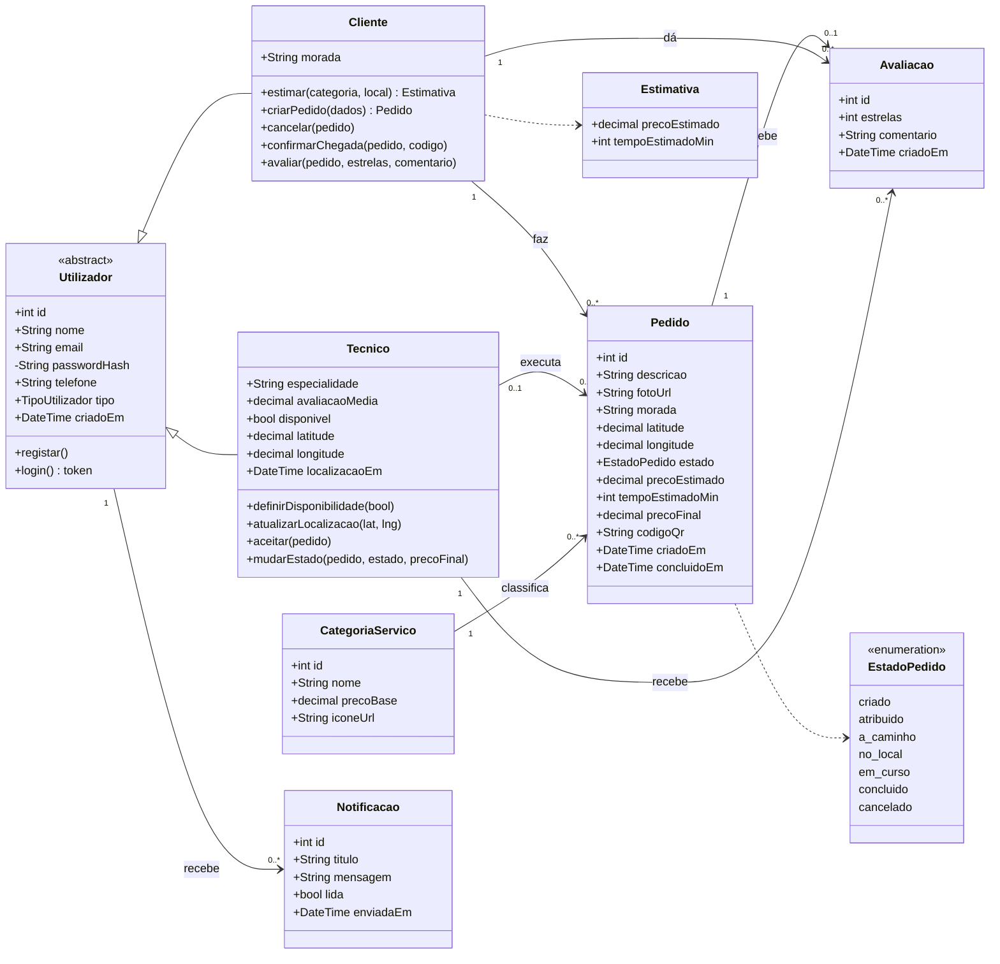
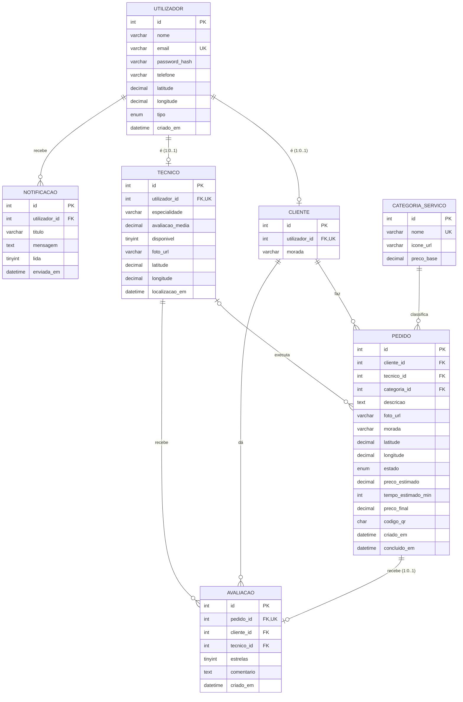

# ProntoFix - Relatório Intermédio

**Universidade Europeia | IADE - Faculdade de Design, Tecnologia e Comunicação.**

### Integrantes do Grupo

| Nome | N.º de estudante |
|---|---|
| Emanuel Jacinto | 20251741 |
| Paulo Tibúrcio | 20252415 |
| Márcio Nhanga | 20252075 |
| Narciso Correia | 20251969 |

Licenciatura em Engenharia Informática | 3º semestre | 2026-2027 Projeto Multidisciplinar | **Grupo 04**

- **Repositório:** <https://github.com/IADE-Informatica-Grupo04/ProntoFix>
- **Mock-ups Figma:** [ProntoFix – Figma](https://www.figma.com/design/HrEaTVDkBjhdbS3D8eG3up/ProntoFix?node-id=2-235&t=P2uSqY81BsGhZQlm-0)
- **Github Projecto:** <https://www.figma.com/design/HrEaTVDkBjhdbS3D8eG3up/ProntoFix?node-id=7-2&p=f&t=p5Bb5hwKgvmV4fnc-0>

---

## 1. Palavras-chave

Reparações urgentes, serviços ao domicílio, geolocalização, QR Code, aplicação móvel, Flutter, Node.js, API REST, MySQL.

## 2. A app e o problema

O **ProntoFix** é uma app móvel para pedir **reparações urgentes ao domicílio** (canalização, eletricidade, serralharia e outras categorias). O cliente escolhe a categoria, descreve o problema e indica a morada. Antes de confirmar vê o **preço estimado e o tempo de chegada**. O servidor **atribui o pedido automaticamente ao prestador livre mais próximo** da categoria. O cliente acompanha o estado do pedido, **confirma a chegada do prestador por QR Code** e, no fim, paga e avalia.

**Problema.** Numa emergência doméstica é difícil encontrar depressa um profissional de confiança, com preço claro e hora de chegada previsível. A pesquisa de utilizadores da UC de Interfaces e Usabilidade (13 clientes e 10 prestadores inquiridos) mostrou que **a confiança pesa mais do que a rapidez**: 8 dos 13 clientes apontaram a confiança e a qualidade como a maior dificuldade. Do lado dos prestadores, 6 em 9 dão prioridade ao pagamento garantido e rápido.

## 3. Objetivos e motivação

As plataformas existentes (Oscar, Zaask, Habitissimo) são generalistas ou funcionam por orçamentos, um modelo que não serve urgências. O objetivo é ligar o cliente ao prestador disponível mais próximo de forma **rápida, transparente e verificável**:

1. criar um pedido urgente em poucos toques;
2. mostrar o preço e a chegada estimados antes de confirmar;
3. atribuir o pedido automaticamente ao prestador livre mais próximo;
4. acompanhar o estado do pedido e confirmar a chegada por QR Code;
5. registar o preço final, o histórico e a avaliação;
6. dar ao prestador uma versão própria (disponibilidade, pedidos e estado do serviço).

## 4. Público-alvo e personas (versão final)

**Clientes:** pessoas que precisam de uma reparação urgente em casa (arrendatários, famílias, pessoas mais velhas).
**Prestadores:** canalizadores, eletricistas, serralheiros e outros profissionais independentes que querem pedidos próximos e pagamento garantido.

As personas foram construídas a partir dos dois inquéritos da UC de Interfaces e Usabilidade (Fase 1). São ilustrativas, mas assentes nos dados recolhidos.

| | **Marta Gonçalves** (cliente) | **Rui Pereira** (prestador) |
|---|---|---|
| Perfil | 24 anos, contabilista, arrendatária em Lisboa | 45 anos, canalizador independente, Grande Lisboa |
| Citação | "Este orçamento só chega amanhã, e eu preciso hoje!" | "Quero pedidos perto de mim e receber sem andar atrás de clientes." |
| Objetivos | Encontrar um profissional fiável sem perder tempo e saber quando chega | Receber mais pedidos na sua zona, com pagamento garantido e rápido |
| Frustrações | Não conhece profissionais de confiança; orçamentos tardios; poucas avaliações reais | Poucos pedidos urgentes por semana; gere tudo por chamada, WhatsApp e agenda de papel |
| O que o ProntoFix lhe dá | Preço e chegada antes de confirmar, prestador avaliado, estado do pedido em tempo real, QR de chegada | Pedidos atribuídos por proximidade, disponibilidade num toque, preço final registado |

*Alteração face à v1:* a Marta passou de 34 para 24 anos, para refletir a amostra do inquérito (8 em 13 clientes têm entre 18 e 24 anos).

## 5. Pesquisa de mercado (resumo)

| | Oscar | Zaask · Habitissimo | **ProntoFix** |
|---|---|---|---|
| Foco em urgências | Parcial | Não | **Sim (core)** |
| Preço | Fixo | Orçamentos | **Estimativa à partida** |
| Acompanhamento | Não confirmado | Não | **Estado em tempo real** |
| Confirmação de chegada | Não confirmado | Não | **QR Code no local** |

O diferencial não pode ser só a rapidez: tem de ser sobretudo a **confiança** (prestador avaliado, preço claro, chegada verificada).

## 6. Guiões de teste e casos de utilização (versão final)

Os guiões descrevem o fluxo **tal como está implementado na versão alfa**. Os passos ainda simulados estão assinalados com *(simulado)*.

### Guião 1 — Pedir uma reparação urgente (core)

**Ator:** Marta (cliente). **Situação:** um cano rebentou na cozinha. **Pré-condição:** sessão iniciada como cliente; existe um canalizador disponível.

1. No ecrã inicial, toca em **"Pedir ajuda"** e escolhe a categoria **Canalização**.
2. Descreve o problema (a foto é opcional) e escolhe a urgência.
3. Confirma a morada do serviço *(mapa ilustrativo; localização fixa enquanto não há GPS)*.
4. A app pede a estimativa ao servidor (`POST /pedidos/estimativa`) e mostra **preço e tempo de chegada**.
5. Confirma o pedido (`POST /pedidos`). O servidor atribui-o ao canalizador livre mais próximo (estado **Atribuído**).
6. No acompanhamento (atualizado a cada 3 s), vê o prestador, a avaliação dele e o estado: **A caminho**.
7. Quando o prestador chega, toca em **"Confirmar chegada (QR)"** e introduz o código que ele mostra (`POST /pedidos/:id/chegada`). O estado passa a **No local**.
8. O prestador conclui o serviço; a app mostra o **preço final**.
9. Paga *(simulado)* e avalia de 1 a 5 estrelas (`POST /pedidos/:id/avaliacao`).

**Resultado:** pedido concluído, com preço final, pago e avaliado.

### Guião 2 — Receber e executar um pedido (prestador)

**Ator:** Rui (prestador). **Pré-condição:** sessão iniciada como prestador, com especialidade igual à categoria do pedido.

1. Abre o painel. A app envia a **localização** e a **disponibilidade** (`PATCH /prestadores/me/localizacao` e `/disponibilidade`).
2. Quando um pedido lhe é atribuído, o painel mostra-o (atualizado a cada 4 s): categoria, cliente, morada, estimativa e chegada.
3. Toca em **"Aceitar e ir a caminho"** (`POST /pedidos/:id/aceitar`). O estado passa a **A caminho** e aparece o **QR Code**.
4. No local, mostra o QR ao cliente. Quando o cliente o confirma, o estado passa a **No local**.
5. Toca em **"Começar serviço"** (estado **Em curso**).
6. No fim, toca em **"Concluir serviço"** e indica o **preço final** (por omissão, a estimativa).

**Resultado:** serviço concluído e preço final registado.

### Guião 3 — Consultar pedidos, cancelar e rever o histórico (cliente)

**Ator:** Marta. **Pré-condição:** tem pedidos feitos.

1. Abre **"Pedidos"** e vê os pedidos ativos com o estado de cada um.
2. Abre um pedido que ainda não começou e toca em **"Cancelar pedido"** (`PATCH /pedidos/:id/cancelar`). A app pede confirmação.
3. Abre **"Histórico"**, pesquisa por serviço ou prestador e consulta os pedidos concluídos e cancelados.
4. Num pedido concluído e ainda não avaliado, toca em **"Avaliar serviço"**.

**Resultado:** pedido cancelado e histórico consultado.
*Alteração face à v1:* "Repetir pedido" e "Favoritos" (RF11 e RF12, prioridade baixa) passam para a entrega final.

### Casos de utilização

| ID | Caso de utilização | Ator | Pré-condições | Fluxo principal | Alternativas e exceções |
|---|---|---|---|---|---|
| **UC1 (core)** | Pedir reparação urgente | Cliente | Sessão iniciada | Guião 1, passos 1–9 | Sem prestador livre: o pedido fica **Criado** e a estimativa não tem tempo de chegada. Código QR errado: erro 400 e nova tentativa. |
| UC2 | Executar um pedido | Prestador | Disponível, com localização e sem pedido ativo | Guião 2, passos 1–6 | Pedido já cancelado ou aceite: erro 409. Concluir antes de começar: erro 409. |
| UC3 | Cancelar um pedido e consultar o histórico | Cliente | Ter pedidos | Guião 3, passos 1–4 | Pedido já em curso: não pode ser cancelado (erro 409). |

## 7. Descrição da solução

### 7.1 Descrição genérica

O ProntoFix tem três partes: a **app móvel** (Flutter, com uma área para clientes e outra para prestadores), a **API REST** (Node.js) e a **base de dados relacional** (MySQL). Nesta 2.ª entrega, a versão alfa liga as três partes: a app consome os serviços da API, e a API guarda e lê tudo da base de dados. O sistema atribui cada pedido ao prestador disponível, da categoria certa, mais próximo, e gere o ciclo completo do serviço, do pedido à avaliação.

#### Estado da versão alfa

| Funcionalidade | Estado |
|---|---|
| Registo e login (JWT), perfis cliente e prestador | Implementado |
| Categorias, estimativa de preço e chegada | Implementado |
| Criar pedido com atribuição automática ao mais próximo | Implementado |
| Acompanhamento do estado (*polling*) | Implementado |
| Aceitar, a caminho, QR de chegada, em curso, concluir com preço final | Implementado |
| Cancelar pedido, histórico, avaliação com média do prestador | Implementado |
| Disponibilidade e localização do prestador | Implementado (localização fixa de teste) |
| GPS real e mapa com a posição do prestador | Por fazer (a API já devolve `prestador_latitude` e `prestador_longitude`) |
| Leitura do QR com a câmara | Por fazer (o código é introduzido ou colado) |
| Pagamento | Simulado na app (sem rota nem tabela) |
| Notificações push | Por fazer (a tabela `notificacao` existe; a app usa *polling*) |
| Recusa e reatribuição do pedido (RF17 e RF23) | Por fazer |
| Favoritos e repetir pedido (RF11 e RF12) | Adiado para a entrega final |

### 7.2 Enquadramento nas unidades curriculares

| UC | Contributo nesta entrega |
|---|---|
| Programação de Dispositivos Móveis | App Flutter ligada à API; servidor Node.js REST; documentação REST |
| Bases de Dados | Modelo ER, `create.sql`, `populate.sql`, `queries.sql` (40 consultas), dicionário e guia de dados |
| Interfaces e Usabilidade | Personas, journey map, avaliação heurística (13 problemas, 4 graves), Style Guide, mockups Figma |
| Redes e Comunicação de Dados | Arquitetura cliente-servidor HTTP/JSON com autenticação por token |
| Matemática Discreta | Distância de Haversine na atribuição; a estimativa é o ponto de entrada do método numérico (por definir com os docentes) |

### 7.3 Requisitos técnicos e regras de negócio

- **Estimativa:** `preço = preco_base + km × 1,5 €` e `chegada = max(5, round(km / 30 × 60) + 5)` minutos, em que `km` é a distância (fórmula de Haversine) ao prestador elegível mais próximo. Sem prestador, a resposta tem só o preço base e o tempo é `null`. A fórmula é **provisória**: será substituída pelo método numérico da UC de Matemática Discreta.
- **Atribuição:** prestador **disponível**, com localização, **sem pedido ativo** e com **especialidade igual ao nome da categoria**; ganha o mais próximo.
- **QR Code:** cada pedido tem um `codigo_qr` (UUID) que só o prestador recebe. O cliente lê-o no local e envia-o. Assim a chegada não pode ser confirmada sem o prestador estar presente.
- **Segurança:** palavras-passe com bcrypt (10 rondas); token JWT `{ id, role, perfilId }` em todas as rotas, exceto o registo e o login; controlo de papel (`cliente` / `tecnico`) e de dono do pedido.

A lista completa de requisitos, com o estado de cada um, está no **Anexo C**.

### 7.4 Arquitetura da solução



- **App (Flutter, MVC):** os ecrãs (`lib/screens`) só mostram dados e chamam o serviço `Api` (`lib/services/api_service.dart`), que faz todos os pedidos HTTP, guarda o token JWT e converte o JSON nos modelos (`lib/models`). O acompanhamento é feito por *polling*: o cliente a cada 3 s e o prestador a cada 4 s.
- **API (Node.js + Express 5, MVC + REST):** `routes → middlewares → controllers → services → models`. Os *services* têm as regras de negócio (estimativa, atribuição, transições de estado). Os *models* só têm SQL.
- **Base de dados:** MySQL, 7 tabelas, com integridade referencial e *checks* (secção 7.8).

#### Ciclo de vida do pedido



Cada transição é **atómica**: um `UPDATE ... WHERE id = ? AND estado IN (...)` só muda o estado se o estado atual for o esperado. Uma transição inválida devolve **409 Conflict**.

### 7.5 Tecnologias utilizadas

| Camada | Tecnologia |
|---|---|
| App | Flutter 3 / Dart 3, pacotes `http` e `qr_flutter`, Android Studio / VS Code |
| Servidor | Node.js, Express 5, mysql2, bcrypt, jsonwebtoken, dotenv, helmet, cors, morgan |
| Base de dados | MySQL 8 (testada também em MariaDB 10.11) |
| Gestão e design | GitHub, GitHub Projects, Figma |

### 7.6 Esboço do diagrama de classes

Diagrama conceptual, centrado nas entidades e nas relações entre elas. Os métodos correspondem às operações expostas pela API.



**Correspondência no código.** No servidor, cada entidade tem um *model* (`utilizador.model.js`, `pedido.model.js`, `prestador.model.js`, `categoria.model.js`) e as operações estão nos *services* (`pedidos.service.js`, `prestadores.service.js`, `auth.service.js`, `estimativa.service.js`, `atribuicao.service.js`). Na app, `Pedido`, `Prestador` e `Utilizador` são classes Dart com `fromJson`, e `EstadoPedido` é um `enum`.

### 7.7 Documentação REST (versão 1)

Formato: *Documenting your API* (Bocoup). Cada rota tem **Title, URL, Method, URL Params, Data Params, Success Response, Error Response, Sample Call** e **Notes**.

**Base URL:** `http://<servidor>:3000`. No emulador Android, `http://10.0.2.2:3000`.
**Autenticação:** todas as rotas, exceto `register` e `login`, exigem o cabeçalho `Authorization: Bearer <token>`. O token JWT contém `{ id, role, perfilId }`: `role` é `cliente` ou `tecnico`, e `perfilId` é o `cliente.id` ou o `tecnico.id`.
**Formato:** JSON em `snake_case`, igual às colunas da base de dados. Os erros vêm sempre como `{ "erro": "mensagem" }`.

**Erros comuns a todas as rotas protegidas**

| Código | Corpo | Quando |
|---|---|---|
| 401 | `{ "erro": "Token em falta" }` | Sem cabeçalho `Authorization` |
| 401 | `{ "erro": "Token inválido" }` | Token expirado ou adulterado |
| 403 | `{ "erro": "Sem permissão" }` | O papel não tem acesso à rota |
| 404 | `{ "erro": "Rota não encontrada" }` | URL inexistente |
| 500 | `{ "erro": "Erro interno" }` | Erro inesperado do servidor |

**Objeto Pedido** (devolvido por várias rotas)

```json
{
  "id": 1, "cliente_id": 1, "tecnico_id": 1, "categoria_id": 1,
  "descricao": "Tomada da sala deixou de funcionar e precisa de reparação",
  "foto_url": null, "morada": "Rua das Flores, Lisboa",
  "latitude": 38.7223, "longitude": -9.1393,
  "estado": "concluido",
  "preco_estimado": 45, "tempo_estimado_min": 15, "preco_final": 50,
  "criado_em": "2026-11-06T00:07:01.000Z", "concluido_em": "2026-11-06T01:07:01.000Z",
  "categoria": "Eletricidade", "cliente_nome": "João Silva",
  "prestador_nome": "Carlos Mendes", "prestador_avaliacao": 5,
  "prestador_latitude": 38.73, "prestador_longitude": -9.14
}
```

`codigo_qr` só aparece nas respostas ao **técnico**. Os campos do prestador são `null` enquanto o pedido não tem técnico.

---

#### 7.7.1 Autenticação

##### Registar utilizador
- **URL:** `/auth/register`
- **Method:** `POST`
- **URL Params:** nenhum
- **Data Params:** `{ "nome": string, "email": string, "password": string (≥ 6), "tipo": "cliente" | "tecnico" | "prestador", "telefone"?: string, "especialidade"?: string }`. A `especialidade` é obrigatória para técnicos e tem de ser igual ao nome de uma categoria.
- **Success Response:** `201` `{ "token": "eyJ…", "utilizador": { "id": 5, "nome": "Rui Pereira", "email": "rui@email.com", "tipo": "tecnico" } }`
- **Error Response:** `400 "Dados em falta ou tipo inválido"` · `400 "Email inválido"` · `400 "A palavra-passe deve ter pelo menos 6 caracteres"` · `400 "Os técnicos têm de indicar a especialidade"` · `409 "Este email já está registado"`
- **Sample Call:** `curl -X POST $API/auth/register -H "Content-Type: application/json" -d '{"nome":"Rui Pereira","email":"rui@email.com","password":"Teste123","tipo":"Prestador","especialidade":"Canalização"}'`
- **Notes:** cria o `utilizador` e o perfil (`cliente` ou `tecnico`) numa só transação. O email é guardado em minúsculas. Não é possível criar contas `admin` por aqui.

##### Iniciar sessão
- **URL:** `/auth/login`
- **Method:** `POST`
- **Data Params:** `{ "email": string, "password": string, "tipo"?: "cliente" | "prestador" }`
- **Success Response:** `200` `{ "token": "eyJ…", "utilizador": { "id": 1, "nome": "João Silva", "email": "joao@email.com", "tipo": "cliente" } }`
- **Error Response:** `400 "Email e palavra-passe obrigatórios"` · `401 "Credenciais inválidas"` (dados errados, ou `tipo` diferente do da conta)
- **Sample Call:** `curl -X POST $API/auth/login -H "Content-Type: application/json" -d '{"email":"joao@email.com","password":"Teste123"}'`
- **Notes:** o token expira ao fim de `JWT_EXPIRES_IN` (1 dia, por omissão).

##### Utilizador da sessão
- **URL:** `/auth/me`
- **Method:** `GET`
- **Success Response:** `200` `{ "id": 1, "role": "cliente", "perfilId": 1, "iat": 1794096463, "exp": 1794182863 }`
- **Error Response:** `401`
- **Sample Call:** `curl $API/auth/me -H "Authorization: Bearer $TOKEN"`
- **Notes:** devolve o conteúdo do token; serve para testar a autenticação.

#### 7.7.2 Categorias

##### Listar categorias
- **URL:** `/categorias`
- **Method:** `GET`
- **Success Response:** `200` `[ { "id": 2, "nome": "Canalização", "preco_base": 45 }, { "id": 1, "nome": "Eletricidade", "preco_base": 50 }, … ]`
- **Error Response:** `401`
- **Sample Call:** `curl $API/categorias -H "Authorization: Bearer $TOKEN"`
- **Notes:** ordenadas por nome. A app usa o `id` em `categoria_id`.

#### 7.7.3 Pedidos (cliente)

##### Estimar preço e chegada
- **URL:** `/pedidos/estimativa`
- **Method:** `POST` (só `cliente`)
- **Data Params:** `{ "categoria_id": int, "latitude": number (−90…90), "longitude": number (−180…180) }`
- **Success Response:** `200` `{ "preco_estimado": 47.1, "tempo_estimado_min": 8 }`. Sem prestador livre: `{ "preco_estimado": 50, "tempo_estimado_min": null }`.
- **Error Response:** `400 "Categoria em falta"` · `400 "Categoria inválida"` · `400 "Localização em falta"` · `400 "Localização inválida"` · `403`
- **Sample Call:** `curl -X POST $API/pedidos/estimativa -H "Authorization: Bearer $TOKEN" -H "Content-Type: application/json" -d '{"categoria_id":1,"latitude":38.7223,"longitude":-9.1393}'`
- **Notes:** `preco_base + km × 1,5 €`; `max(5, round(km / 30 × 60) + 5)` minutos (secção 7.3).

##### Criar pedido
- **URL:** `/pedidos`
- **Method:** `POST` (só `cliente`)
- **Data Params:** `{ "categoria_id": int, "descricao": string, "morada": string, "latitude": number, "longitude": number, "foto_url"?: string }`
- **Success Response:** `201` objeto **Pedido**, com `estado: "atribuido"` (e os dados do prestador) ou `estado: "criado"` se não houver prestador livre.
- **Error Response:** `400 "Dados em falta"` · `400 "Categoria inválida"` · `400 "Localização em falta"` · `400 "Localização inválida"` · `403`
- **Sample Call:** `curl -X POST $API/pedidos -H "Authorization: Bearer $TOKEN" -H "Content-Type: application/json" -d '{"categoria_id":2,"descricao":"Fuga de água","morada":"Rua das Flores, Lisboa","latitude":38.7223,"longitude":-9.1393}'`
- **Notes:** a estimativa é recalculada no servidor (o cliente não a envia). É gerado um `codigo_qr` (UUID v4) e o pedido é atribuído ao prestador elegível mais próximo.

##### Listar os meus pedidos
- **URL:** `/pedidos`
- **Method:** `GET` (só `cliente`)
- **Success Response:** `200` lista de objetos **Pedido**, do mais recente para o mais antigo
- **Error Response:** `401` · `403`
- **Sample Call:** `curl $API/pedidos -H "Authorization: Bearer $TOKEN"`

##### Ver um pedido
- **URL:** `/pedidos/:id`
- **Method:** `GET` (o cliente dono ou o técnico atribuído)
- **URL Params:** `id=[int]`
- **Success Response:** `200` objeto **Pedido** (com `codigo_qr` se for o técnico)
- **Error Response:** `404 "Pedido não encontrado"` · `403 "Sem acesso a este pedido"`
- **Sample Call:** `curl $API/pedidos/1 -H "Authorization: Bearer $TOKEN"`
- **Notes:** é a rota consultada periodicamente no acompanhamento.

##### Cancelar pedido
- **URL:** `/pedidos/:id/cancelar`
- **Method:** `PATCH` (só `cliente` dono)
- **Success Response:** `200` objeto **Pedido** com `estado: "cancelado"`
- **Error Response:** `409 "Este pedido já não pode ser cancelado"` (já em curso, concluído ou cancelado) · `403` · `404`
- **Sample Call:** `curl -X PATCH $API/pedidos/3/cancelar -H "Authorization: Bearer $TOKEN"`
- **Notes:** permitido nos estados `criado`, `atribuido`, `a_caminho` e `no_local`.

##### Confirmar chegada (QR Code)
- **URL:** `/pedidos/:id/chegada`
- **Method:** `POST` (só `cliente` dono)
- **Data Params:** `{ "codigo": string }`, o UUID lido do QR que o prestador mostra
- **Success Response:** `200` objeto **Pedido** com `estado: "no_local"`
- **Error Response:** `409 "O prestador ainda não está a caminho"` · `400 "Código QR inválido"` · `403` · `404`
- **Sample Call:** `curl -X POST $API/pedidos/2/chegada -H "Authorization: Bearer $TOKEN" -H "Content-Type: application/json" -d '{"codigo":"a0000000-0000-4000-8000-000000000002"}'`
- **Notes:** o cliente nunca recebe o `codigo_qr`, por isso não consegue confirmar a chegada sem o prestador estar presente.

##### Avaliar o serviço
- **URL:** `/pedidos/:id/avaliacao`
- **Method:** `POST` (só `cliente` dono)
- **Data Params:** `{ "estrelas": int (1–5), "comentario"?: string }`
- **Success Response:** `201` `{ "mensagem": "Avaliação guardada" }`
- **Error Response:** `409 "Só se avalia um pedido concluído"` · `400 "Estrelas: de 1 a 5"` · `409 "Este pedido já foi avaliado"`
- **Sample Call:** `curl -X POST $API/pedidos/1/avaliacao -H "Authorization: Bearer $TOKEN" -H "Content-Type: application/json" -d '{"estrelas":5,"comentario":"Rápido e simpático"}'`
- **Notes:** recalcula `tecnico.avaliacao_media`. Só é possível uma avaliação por pedido (`UNIQUE pedido_id`).

#### 7.7.4 Pedidos (prestador)

##### Aceitar pedido
- **URL:** `/pedidos/:id/aceitar`
- **Method:** `POST` (só `tecnico` atribuído)
- **Success Response:** `200` objeto **Pedido** com `estado: "a_caminho"` e `codigo_qr`
- **Error Response:** `409 "Este pedido já não pode ser aceite"` · `403 "Sem acesso a este pedido"` · `404`
- **Sample Call:** `curl -X POST $API/pedidos/4/aceitar -H "Authorization: Bearer $TOKEN_TECNICO"`

##### Mudar o estado do serviço
- **URL:** `/pedidos/:id/estado`
- **Method:** `PATCH` (só `tecnico` atribuído)
- **Data Params:** `{ "estado": "em_curso" }` (a partir de `no_local`) ou `{ "estado": "concluido", "preco_final"?: number ≥ 0 }` (a partir de `em_curso`)
- **Success Response:** `200` objeto **Pedido** atualizado (`concluido_em` preenchido ao concluir)
- **Error Response:** `400 "Estado inválido (usa em_curso ou concluido)"` · `400 "Preço final inválido"` · `409 "Não é possível passar a "concluido" a partir de "a_caminho""`
- **Sample Call:** `curl -X PATCH $API/pedidos/2/estado -H "Authorization: Bearer $TOKEN_TECNICO" -H "Content-Type: application/json" -d '{"estado":"concluido","preco_final":85}'`
- **Notes:** sem `preco_final`, é usado o `preco_estimado`.

#### 7.7.5 Prestadores

##### Os meus pedidos ativos
- **URL:** `/prestadores/me/pedidos`
- **Method:** `GET` (só `tecnico`)
- **Success Response:** `200` lista de objetos **Pedido** nos estados `atribuido`, `a_caminho`, `no_local` e `em_curso`, com `codigo_qr`
- **Error Response:** `401` · `403`
- **Sample Call:** `curl $API/prestadores/me/pedidos -H "Authorization: Bearer $TOKEN_TECNICO"`

##### Definir disponibilidade
- **URL:** `/prestadores/me/disponibilidade`
- **Method:** `PATCH` (só `tecnico`)
- **Data Params:** `{ "disponivel": boolean }`
- **Success Response:** `200` `{ "disponivel": true }`
- **Error Response:** `400 ""disponivel" tem de ser true ou false"`
- **Sample Call:** `curl -X PATCH $API/prestadores/me/disponibilidade -H "Authorization: Bearer $TOKEN_TECNICO" -H "Content-Type: application/json" -d '{"disponivel":true}'`

##### Atualizar localização
- **URL:** `/prestadores/me/localizacao`
- **Method:** `PATCH` (só `tecnico`)
- **Data Params:** `{ "latitude": number, "longitude": number }`
- **Success Response:** `200` `{ "latitude": 38.73, "longitude": -9.14 }`
- **Error Response:** `400 "Localização inválida"`
- **Sample Call:** `curl -X PATCH $API/prestadores/me/localizacao -H "Authorization: Bearer $TOKEN_TECNICO" -H "Content-Type: application/json" -d '{"latitude":38.73,"longitude":-9.14}'`
- **Notes:** atualiza também `localizacao_em`. Só técnicos com localização entram na atribuição.

#### 7.7.6 Saúde do servidor (fora de `/api`)

| Rota | Resposta |
|---|---|
| `GET /health` | `{ "status": "ok" }` |
| `GET /health/db` | `{ "status": "ok", "ok": 1, "db": "prontofix" }`, ou `500` se a base de dados não responder |

### 7.8 BD Report

Esta secção descreve a base de dados `prontofix` (MySQL) e os dados de exemplo. Corresponde ao capítulo de base de dados do relatório final.

**Ficheiros (pasta `backend/sql` do repositório):**

| Ficheiro | Conteúdo |
|---|---|
| `create.sql` | Cria a base de dados (`utf8mb4`), as 7 tabelas, as chaves estrangeiras, o *check* das estrelas e 4 índices |
| `populate.sql` | Dados de exemplo fictícios: 6 categorias, 4 utilizadores, 3 pedidos, 1 avaliação, 3 notificações |
| `queries.sql` | 40 consultas (Q01–Q40) e 2 vistas, organizadas em 7 grupos (A–G) |

Ordem de execução: `create.sql` → `populate.sql` → `queries.sql`.

#### 7.8.1 Modelo Entidade-Relação



**Decisões de modelação**

- **Especialização de `utilizador`:** os dados comuns (nome, email, palavra-passe, telefone) ficam em `utilizador`, e os de cada perfil em `cliente` ou `tecnico`. A relação é 1:0..1, garantida por `utilizador_id UNIQUE`. O campo `tipo` diz qual dos perfis existe. As contas `admin` não têm perfil.
- **`tecnico_id` opcional em `pedido`:** um pedido acabado de criar pode ainda não ter técnico (estado `criado`).
- **Estados como `ENUM`:** os 7 estados do ciclo de vida (secção 7.4) ficam garantidos pela própria base de dados.
- **Uma avaliação por pedido:** `avaliacao.pedido_id UNIQUE`, com `CHECK (estrelas BETWEEN 1 AND 5)`. `cliente_id` e `tecnico_id` são redundantes em relação ao pedido, mas tornam diretas as consultas por técnico (média e ranking).
- **`avaliacao_media` desnormalizada em `tecnico`:** evita calcular a média em cada estimativa ou cartão. É recalculada pela API a cada nova avaliação, e a consulta Q33 verifica se está coerente.
- **Políticas `ON DELETE`:** apagar um utilizador apaga o perfil e as notificações (`CASCADE`). Não é possível apagar um cliente, categoria ou técnico com histórico (`RESTRICT`), exceto `pedido.tecnico_id`, que passa a `NULL` (`SET NULL`), para o pedido não se perder.
- **Índices:** `pedido(estado)`, `pedido(criado_em)`, `tecnico(disponivel)` e `notificacao(lida)`. São as colunas usadas nos filtros mais frequentes: pedidos ativos, histórico, atribuição e notificações por ler.

#### 7.8.2 Dicionário de Dados

Legenda: **PK** chave primária · **FK** chave estrangeira · **UK** valor único · **NN** obrigatório.

##### `utilizador` — conta de acesso (todos os perfis)

| Coluna | Tipo | Restrições | Descrição |
|---|---|---|---|
| id | INT UNSIGNED | PK, AUTO_INCREMENT | Identificador |
| nome | VARCHAR(120) | NN | Nome completo |
| email | VARCHAR(180) | NN, UK | Email de login (guardado em minúsculas) |
| password_hash | VARCHAR(255) | NN | Hash bcrypt da palavra-passe |
| telefone | VARCHAR(20) | — | Contacto (opcional) |
| latitude, longitude | DECIMAL(9,6) | — | Localização habitual (opcional) |
| tipo | ENUM('cliente','tecnico','admin') | NN | Perfil da conta |
| criado_em | DATETIME | NN, DEFAULT NOW | Data de registo |

##### `cliente` — perfil de quem pede o serviço

| Coluna | Tipo | Restrições | Descrição |
|---|---|---|---|
| id | INT UNSIGNED | PK | Identificador do cliente (`perfilId` no token) |
| utilizador_id | INT UNSIGNED | NN, UK, FK → utilizador.id (CASCADE) | Conta associada |
| morada | VARCHAR(255) | — | Morada habitual |

##### `tecnico` — perfil do prestador

| Coluna | Tipo | Restrições | Descrição |
|---|---|---|---|
| id | INT UNSIGNED | PK | Identificador do técnico (`perfilId` no token) |
| utilizador_id | INT UNSIGNED | NN, UK, FK → utilizador.id (CASCADE) | Conta associada |
| especialidade | VARCHAR(100) | NN | Igual ao `nome` de uma categoria (regra de atribuição) |
| avaliacao_media | DECIMAL(3,2) | — | Média das estrelas, de 0,00 a 5,00 |
| disponivel | TINYINT(1) | NN, DEFAULT 1 | 1 = recebe pedidos |
| foto_url | VARCHAR(500) | — | Fotografia do perfil |
| latitude, longitude | DECIMAL(9,6) | — | Última localização conhecida |
| localizacao_em | DATETIME | — | Data e hora da última localização |

##### `categoria_servico` — tipos de serviço

| Coluna | Tipo | Restrições | Descrição |
|---|---|---|---|
| id | INT UNSIGNED | PK | Identificador (`categoria_id` na API) |
| nome | VARCHAR(80) | NN, UK | Nome mostrado na app |
| icone_url | VARCHAR(500) | — | Ícone da categoria |
| preco_base | DECIMAL(8,2) | NN, DEFAULT 40.00 | Base da estimativa de preço (€) |

##### `pedido` — pedido de reparação

| Coluna | Tipo | Restrições | Descrição |
|---|---|---|---|
| id | INT UNSIGNED | PK | Identificador |
| cliente_id | INT UNSIGNED | NN, FK → cliente.id (RESTRICT) | Quem pediu |
| tecnico_id | INT UNSIGNED | FK → tecnico.id (SET NULL) | Técnico atribuído (`NULL` em `criado`) |
| categoria_id | INT UNSIGNED | NN, FK → categoria_servico.id (RESTRICT) | Tipo de serviço |
| descricao | TEXT | NN | Descrição do problema |
| foto_url | VARCHAR(500) | — | Fotografia do problema |
| morada | VARCHAR(255) | — | Local do serviço (a API exige-a) |
| latitude, longitude | DECIMAL(9,6) | — | Coordenadas do serviço (a API exige-as) |
| estado | ENUM(…7 estados) | NN, DEFAULT 'criado' | `criado`, `atribuido`, `a_caminho`, `no_local`, `em_curso`, `concluido`, `cancelado` |
| preco_estimado | DECIMAL(8,2) | — | Estimativa mostrada ao cliente (€) |
| tempo_estimado_min | INT | — | Chegada prevista em minutos (`NULL` sem técnico livre) |
| preco_final | DECIMAL(8,2) | — | Valor indicado pelo técnico ao concluir |
| codigo_qr | CHAR(36) | — | UUID que confirma a chegada (só o técnico o vê) |
| criado_em | DATETIME | NN, DEFAULT NOW | Data do pedido |
| concluido_em | DATETIME | — | Data de conclusão |

##### `avaliacao` — avaliação do serviço

| Coluna | Tipo | Restrições | Descrição |
|---|---|---|---|
| id | INT UNSIGNED | PK | Identificador |
| pedido_id | INT UNSIGNED | NN, UK, FK → pedido.id (CASCADE) | Pedido avaliado (no máximo uma avaliação) |
| cliente_id | INT UNSIGNED | NN, FK → cliente.id (RESTRICT) | Quem avaliou |
| tecnico_id | INT UNSIGNED | NN, FK → tecnico.id (RESTRICT) | Quem foi avaliado |
| estrelas | TINYINT | NN, CHECK 1–5 | Classificação |
| comentario | TEXT | — | Comentário opcional |
| criado_em | DATETIME | NN, DEFAULT NOW | Data da avaliação |

##### `notificacao` — mensagens para o utilizador

| Coluna | Tipo | Restrições | Descrição |
|---|---|---|---|
| id | INT UNSIGNED | PK | Identificador |
| utilizador_id | INT UNSIGNED | NN, FK → utilizador.id (CASCADE) | Destinatário |
| titulo | VARCHAR(150) | NN | Título |
| mensagem | TEXT | NN | Texto |
| lida | TINYINT(1) | NN, DEFAULT 0 | 0 = por ler, 1 = lida |
| enviada_em | DATETIME | NN, DEFAULT NOW | Data de envio |

#### 7.8.3 Guia de Dados (BD exemplo)

Todos os dados são **fictícios** (RGPD). Todas as contas têm a palavra-passe **`Teste123`**, guardada com bcrypt.

| Tabela | Linhas | O que representa |
|---|---|---|
| categoria_servico | 6 | Eletricidade (50 €), Canalização (45 €), Pintura (55 €), Carpintaria (55 €), Limpeza (35 €), Serralharia (60 €) |
| utilizador | 4 | João Silva e Ana Costa (clientes), Carlos Mendes (técnico), Admin ProntoFix |
| cliente | 2 | João (Rua das Flores, Lisboa) e Ana (Avenida Central, Porto) |
| tecnico | 1 | Carlos Mendes, Eletricidade, média 5,00, disponível, em Lisboa (38,73; −9,14) |
| pedido | 3 | Um pedido em cada fase importante (tabela seguinte) |
| avaliacao | 1 | 5 estrelas do João ao Carlos (pedido 1) |
| notificacao | 3 | Pedido concluído (João), novo serviço (Carlos), pedido em progresso (Ana, já lida) |

**Cenários representados pelos pedidos**

| Pedido | Cliente | Categoria | Estado | Técnico | Estimado → final | Situação que ilustra |
|---|---|---|---|---|---|---|
| 1 | João | Eletricidade | concluido | Carlos | 45 € → 50 € | Ciclo completo, com avaliação (há 2 dias, 60 min de serviço) |
| 2 | Ana | Canalização | em_curso | Carlos | 80 € | Serviço a decorrer: o técnico fica ocupado |
| 3 | João | Pintura | criado | — | 60 € | À espera de prestador (não há pintores) |

Os códigos QR seguem o padrão `a0000000-0000-4000-8000-00000000000N`, para facilitar os testes.

**Contas para demonstração:** `joao@email.com` (cliente), `ana@email.com` (cliente), `carlos@email.com` (técnico) e `admin@prontofix.com` (sem acesso à app).

#### 7.8.4 Consultas (`queries.sql`)

As 40 consultas estão escritas para MySQL, com parâmetros no início do ficheiro (`@cliente_id`, `@tecnico_id`, `@lat`, `@lng`…).

| Grupo | Consultas | Técnicas SQL | Exemplos |
|---|---|---|---|
| A. Básicas | Q01–Q07 | `JOIN`, `LEFT JOIN`, filtros, `TIMESTAMPDIFF` | Pedidos ativos do prestador (Q05); pedidos à espera e minutos em espera (Q06) |
| B. Agregações | Q08–Q16 | `GROUP BY`, `HAVING`, `SUM`, `AVG`, `COALESCE`, subconsultas escalares | Receita por categoria (Q09); estimado vs final (Q15); resumo do dia do prestador (Q16) |
| C. Subconsultas | Q17–Q23 | `NOT EXISTS`, `NOT IN`, subconsulta correlacionada | Pedidos acima da média da categoria (Q20); clientes recorrentes (Q22) |
| D. Atribuição | Q24–Q26 | Fórmula de Haversine em SQL, tabela derivada, `GREATEST` | Prestador livre mais próximo (Q24, a mesma regra da API); estimativa (Q26) |
| E. Vistas | 2 vistas, Q27–Q28 | `CREATE VIEW`, `CASE WHEN` em agregações | `v_pedido_detalhe` e `v_desempenho_tecnico` (ranking) |
| F. Integridade | Q29–Q33 | Verificações que devem devolver 0 linhas | Técnico com dois serviços ativos (Q32); média guardada ≠ média real (Q33) |
| G. Operações | Q34–Q40 | `UPDATE` condicionais, `INSERT … SELECT`, transação com `ROLLBACK` | Transição de estado segura (Q35); recálculo das médias (Q38) |

**Resultados sobre a BD exemplo** (testado em MariaDB 10.11): as 40 consultas e as 2 vistas correm sem erros. Exemplos:

- Q09 e Q10: 50 € de receita, todos em Eletricidade, ganhos pelo Carlos (1 serviço).
- Q14 e Q15: o serviço de eletricidade demorou 60 minutos e o preço final ficou 5 € acima da estimativa.
- Q29 a Q33: **0 linhas**, como esperado.
- Q36: a transição inválida é rejeitada (0 linhas afetadas). A transação termina em `ROLLBACK`, por isso os dados não mudam.

## 8. Planeamento e calendarização

### 8.1 Distribuição de tarefas

A distribuição de tarefas mantém-se a da proposta v1.

| Elemento | Área principal | Área de apoio |
|---|---|---|
| Emanuel Jacinto | Backend: API REST, autenticação, atribuição de pedidos | Coordenação do grupo e GitHub Projects |
| Paulo Tibúrcio | App Flutter, módulo cliente (pedido, mapa, GPS) | Integração app-servidor |
| Márcio Nhanga | Base de dados MySQL (ER, create, populate, queries) | Matemática Discreta |
| Narciso Correia | Design e usabilidade (Figma, avaliação heurística, testes) | App Flutter, módulo prestador, QR Code, notificações |

### 8.2 Gráfico de Gantt

Planeamento da proposta v1. As marcas a vermelho são as três entregas: 02.10, 06.11 e 11.12.


### 8.3 Ponto de situação (2.ª entrega)

Ponto de situação dos pacotes da WBS (Anexo B da proposta v1).

| WBS | Pacote | Estado (2.ª entrega) | Até à entrega final (11.12) |
|---|---|---|---|
| 1.1 | Gestão do projeto | GitHub Projects em uso; repositório com a estrutura de arquivo | Manter o acompanhamento semanal e atualizar o Gantt |
| 1.2 | Análise e conceptualização | Guiões, casos de utilização e personas finais (secções 4 e 6) | Atualizar os casos de utilização |
| 1.3 | Design e interfaces | Fase 1 de I&U entregue (pesquisa, personas, avaliação heurística, Style Guide); mockups no Figma | Fase 2 de I&U: task flow, wireframes, testes de usabilidade (prazo 15.12) |
| 1.4 | Base de dados | `create`, `populate` e `queries`; BD Report (secção 7.8) | Alargar a BD exemplo; tabela `pagamento`; versão final do dicionário e do guia |
| 1.5 | Backend | API REST com 16 rotas, JWT, atribuição e estimativa; documentação (secção 7.7) | Notificações, recusa e reatribuição, pagamento, HTTPS |
| 1.6 | Aplicação móvel | Versão alfa ligada à API (cliente e prestador) | GPS e mapa, leitura do QR com a câmara, notificações, app no telemóvel |
| 1.7 | Matemática Discreta | Haversine e estimativa provisória | Método numérico (Monte Carlo para o tempo de chegada, a validar) e estatística |
| 1.8 | Testes | Teste automático da API ao fluxo completo e aos erros; consultas de integridade | Testes de usabilidade (I&U) e testes na app |
| 1.9 | Documentação e entregas | Este relatório intermédio | Relatório final, manual do utilizador, poster, vídeo e apresentação |

## 9. Conclusão

### 9.1 Alterações face à proposta v1

| Tema | Proposta v1 | Versão atual | Motivo |
|---|---|---|---|
| Atribuição | Pedido enviado aos prestadores mais próximos; o primeiro a aceitar fica com ele | O servidor atribui ao prestador **livre mais próximo**, que aceita o pedido | Mais simples e determinístico para uma fase inicial; evita corridas entre prestadores |
| Estados | Criado → Atribuído → A caminho → No local → Em curso → Concluído | Iguais, agora garantidos pela BD (`ENUM`) e por transições atómicas | — |
| Categorias | Canalização, eletricidade e serralharia | 6 categorias, com preço base | Cumprir o RNF11 (novas categorias sem mudar o código) |
| Pagamento | Entidade *Pagamento* | Simulado na app, ainda sem tabela | Prioridade à versão alfa; tabela prevista para a final |
| Notificações | Firebase Cloud Messaging | Tabela `notificacao`; a app consulta o estado periodicamente | A integração com o FCM fica para a versão final |
| Favoritos e repetir (RF11, RF12) | Previstos | Adiados | Prioridade baixa; o foco está no fluxo urgente |
| Persona Marta | 34 anos | 24 anos | Alinhamento com a amostra do inquérito de I&U |

São alterações de âmbito e não mudam a ideia nem as tecnologias principais. Se os docentes as considerarem significativas, serão documentadas numa `g04-proposta-v2.pdf`.

### 9.2 Conclusão e próximos passos

A versão alfa já cumpre o fluxo principal do ProntoFix de ponta a ponta. A app Flutter consome a API REST em Node.js, que guarda tudo em MySQL. O cliente pede, vê o preço e a chegada, o pedido é atribuído ao prestador livre mais próximo, a chegada é confirmada por QR Code e o serviço termina com preço final e avaliação. A base de dados tem integridade referencial, *checks* e 40 consultas que cobrem as necessidades da app e da gestão.

Para a entrega final, as prioridades são as seguintes:

1. GPS e mapa reais.
2. Leitura do QR com a câmara.
3. Notificações.
4. O método numérico de Matemática Discreta na estimativa.
5. Os testes de usabilidade.
6. O manual do utilizador.

## 10. Bibliografia

- Universidade Europeia / IADE (2026). *Projeto Mobile — Project Briefing (L-EI)*, 2026-2027, 3.º semestre.
- Grupo 04 (2026). *ProntoFix — Proposta de Projeto (v1)*. `Documentos/g04-proposta-v1.pdf`.
- Grupo 04 (2026). *ProntoFix — Interfaces e Usabilidade, Fase 1* (pesquisa de utilizadores, personas, avaliação heurística, Style Guide).
- Rocha, Andrade & Sampaio (2014). Heurísticas de usabilidade para aplicações móveis de ecrã tátil (HMT 1–11), referência da UC de Interfaces e Usabilidade.
- Bocoup. *Documenting your API*. <https://bocoup.com/blog/documenting-your-api>
- Flutter. Documentação oficial. <https://docs.flutter.dev>
- Node.js. Documentação oficial. <https://nodejs.org/docs>
- Express. Documentação oficial. <https://expressjs.com>
- MySQL. *MySQL 8.0 Reference Manual*. <https://dev.mysql.com/doc/>
- IETF (2015). *RFC 7519 — JSON Web Token (JWT)*. <https://www.rfc-editor.org/rfc/rfc7519>
- Regulamento (UE) 2016/679 (RGPD). <https://eur-lex.europa.eu/eli/reg/2016/679/oj>

## Anexos

### Anexo A — Project Charter

O Project Charter mantém-se o da proposta v1 (Anexo A). Atualização dos riscos:

| Risco | Estado na 2.ª entrega | Mitigação |
|---|---|---|
| Complexidade do mapa e do tempo real | Acompanhamento por *polling* a funcionar; mapa e GPS ainda por fazer | A API já devolve a localização do prestador; falta só o ecrã de mapa |
| Integração entre app, API e base de dados | Feita: o fluxo completo funciona de ponta a ponta | Teste automático da API ao fluxo completo e aos erros |
| Dados de teste pouco representativos | A BD exemplo é pequena (secção 7.8.5) | Alargar o `populate.sql` antes da entrega final |
| Atrasos (1 valor por dia) | — | Acompanhamento semanal no GitHub Projects |

### Anexo B — WBS

A WBS mantém-se a da proposta v1 (Anexo B). O ponto de situação de cada pacote está na secção 8.3.

### Anexo C — Requisitos (com estado)

Legenda: **Feito** · **Parcial** (parte feita, o resto indicado) · **Por fazer** · **Adiado** (passa para depois da entrega final, se houver tempo).

#### Requisitos funcionais — Cliente

| ID | Requisito | Prioridade | Estado |
|---|---|---|---|
| RF01 | Registar-se e iniciar sessão | Alta | Feito (JWT) |
| RF02 | Criar um pedido urgente (categoria, descrição, foto) | Alta | Parcial: a API aceita `foto_url`; falta a câmara na app |
| RF03 | Obter localização por GPS e confirmar a morada | Alta | Parcial: confirmação da morada; GPS por fazer |
| RF04 | Ver estimativa de preço e de tempo de chegada | Alta | Feito |
| RF05 | Receber notificação quando um prestador aceita | Alta | Parcial: o estado atualiza-se sozinho; *push* por fazer |
| RF06 | Acompanhar o prestador no mapa em tempo real | Alta | Parcial: a API devolve a posição; mapa por fazer |
| RF07 | Confirmar a chegada do prestador por QR Code | Média | Parcial: validação no servidor; leitura com a câmara por fazer |
| RF08 | Confirmar a conclusão e pagar (simulado) | Alta | Feito (pagamento simulado na app) |
| RF09 | Avaliar o prestador | Média | Feito |
| RF10 | Consultar o histórico de pedidos | Média | Feito |
| RF11 | Repetir um pedido anterior | Baixa | Adiado |
| RF12 | Marcar prestadores como favoritos | Baixa | Adiado |
| RF13 | Cancelar um pedido antes da aceitação | Média | Feito (alargado: até o serviço começar) |

#### Requisitos funcionais — Prestador

| ID | Requisito | Prioridade | Estado |
|---|---|---|---|
| RF14 | Registar-se com categorias de serviço e ser validado | Alta | Parcial: especialidade no registo; validação por fazer |
| RF15 | Ativar e desativar o estado "Disponível" | Alta | Feito |
| RF16 | Receber notificações de novos pedidos próximos | Alta | Parcial: o painel atualiza-se a cada 4 s; *push* por fazer |
| RF17 | Consultar, aceitar ou recusar um pedido | Alta | Parcial: consultar e aceitar; recusar por fazer |
| RF18 | Ver a rota até à morada do cliente | Média | Por fazer |
| RF19 | Apresentar o QR Code à chegada | Média | Feito |
| RF20 | Atualizar o estado do serviço | Alta | Feito |
| RF21 | Consultar ganhos e avaliações | Baixa | Parcial: consulta Q16 na BD; ecrã por fazer |

#### Requisitos funcionais — Sistema

| ID | Requisito | Prioridade | Estado |
|---|---|---|---|
| RF22 | Atribuir o pedido ao prestador disponível mais próximo na categoria certa | Alta | Feito |
| RF23 | Reatribuir ao seguinte se não houver resposta num tempo limite | Média | Por fazer (consulta Q25 já preparada) |
| RF24 | Calcular estimativa de preço e de tempo de chegada | Média | Feito (fórmula provisória) |

#### Requisitos não funcionais

| ID | Categoria | Requisito | Estado |
|---|---|---|---|
| RNF01 | Desempenho | Atribuição em poucos segundos após a confirmação | Feito: a atribuição é feita no próprio pedido |
| RNF02 | Usabilidade | Pedido urgente em 5 toques, no máximo | A validar nos testes de usabilidade |
| RNF03 | Usabilidade | Interface clara em situação de stress | Avaliação heurística feita (I&U, Fase 1) |
| RNF04 | Segurança | HTTPS e palavras-passe com hash | Parcial: bcrypt feito; HTTPS por fazer |
| RNF05 | Segurança | Autenticação por token nas chamadas à API | Feito (JWT e controlo de papel) |
| RNF06 | Privacidade | RGPD: dados mínimos, consentimento para a localização, dados fictícios | Parcial: só dados fictícios; consentimento quando houver GPS |
| RNF07 | Compatibilidade | Flutter multiplataforma, com foco em Android | Feito |
| RNF08 | Arquitetura | Módulos separados em MVC e REST | Feito |
| RNF09 | Manutenção | Código no GitHub e documentação REST atualizada | Feito (secção 7.7) |
| RNF10 | Disponibilidade | Mensagens claras e nova tentativa em falhas de rede | Feito |
| RNF11 | Escalabilidade | Novas categorias sem alterar o núcleo | Feito (categorias na BD) |

### Anexo D — Modelo do domínio (atualizado)

| Entidade | Atributos principais | Alteração face à v1 |
|---|---|---|
| Utilizador | id, nome, email, telefone, palavra-passe (hash), tipo | `tipo` distingue cliente, técnico e admin |
| Cliente | morada | Especialização de Utilizador (1:1) |
| Prestador (técnico) | especialidade, disponível, avaliação média, última localização e respetiva data | "validado" ainda não existe |
| Categoria | id, nome, preço base | Acrescentado o preço base |
| Pedido | descrição, foto, morada, lat/long, estado, preço estimado, tempo estimado, preço final, código QR, datas | Acrescentado o tempo estimado |
| Avaliação | estrelas (1 a 5), comentário, data | — |
| Notificação | título, mensagem, lida, data | — |
| Pagamento | valor, método, estado, data | Ainda não implementado (secção 7.8.5) |

**Regras de negócio (atualizadas):**

- Um pedido pertence a um cliente e a uma categoria. Fica com prestador quando é atribuído (estado `atribuido`), e não apenas depois de aceite.
- Só recebem pedidos os prestadores disponíveis, com localização, sem pedido ativo e com a especialidade da categoria.
- Cada pedido tem no máximo uma avaliação, e só depois de concluído.
- O código QR é gerado por pedido e só o prestador atribuído o recebe.

### Anexo E — Mockups e interfaces

Mockups no Figma: [ProntoFix – Figma](https://www.figma.com/design/HrEaTVDkBjhdbS3D8eG3up/ProntoFix?node-id=2-235&t=P2uSqY81BsGhZQlm-0) (página "Mockups ProntoFix — Pro").

| Área | Ecrãs da versão alfa |
|---|---|
| Comum | Splash, Login, Criar conta, Perfil, Ajuda |
| Cliente | Início, Novo pedido (categoria, descrição, urgência), Localização e estimativa, Acompanhamento (com confirmação por QR), Pagamento, Avaliação, Pedidos, Histórico, Mensagens |
| Prestador | Painel (disponibilidade, pedido atribuído, QR, começar e concluir), Pedidos ativos |
